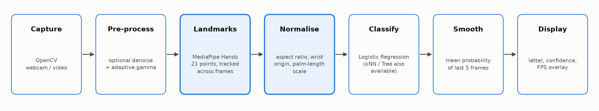
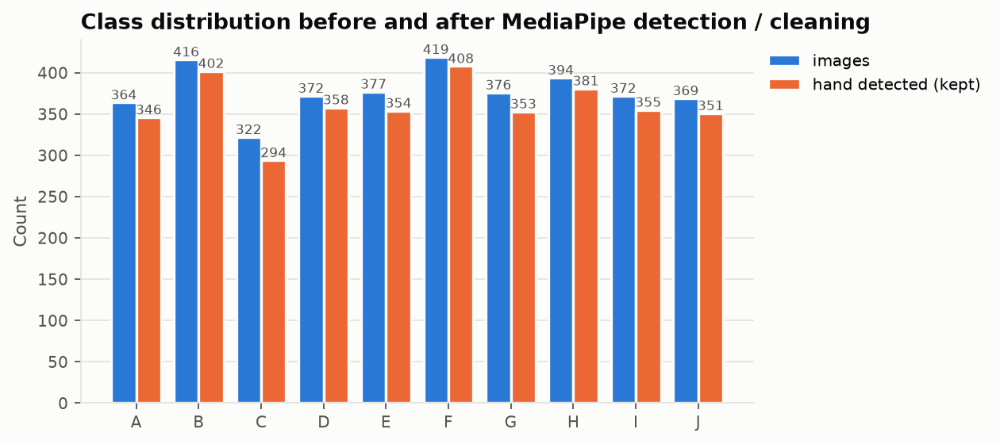
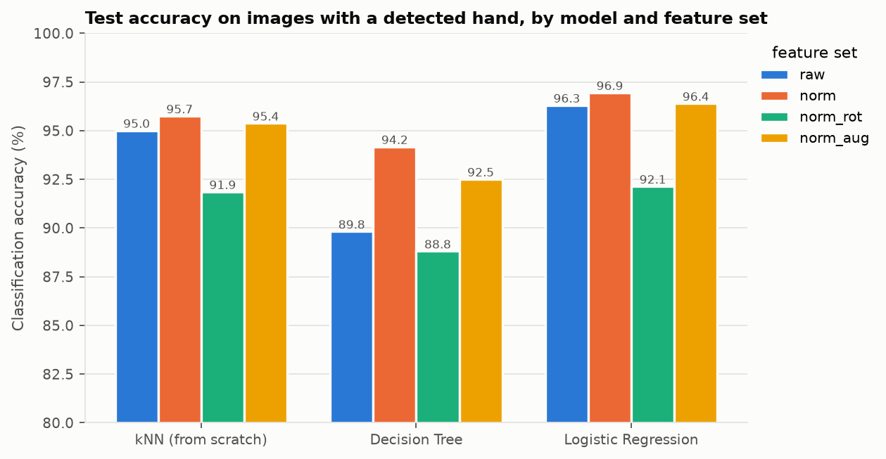
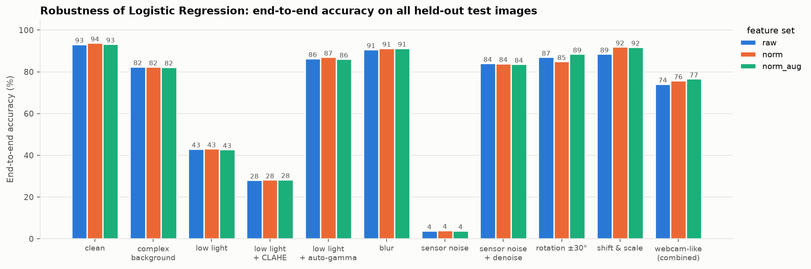
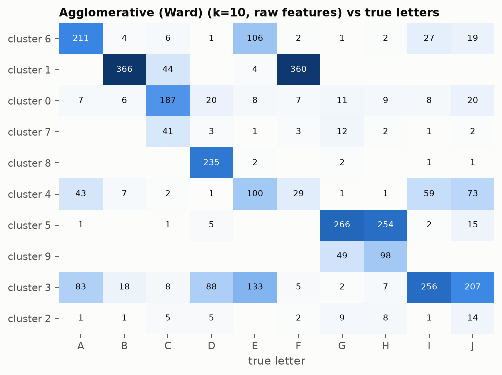
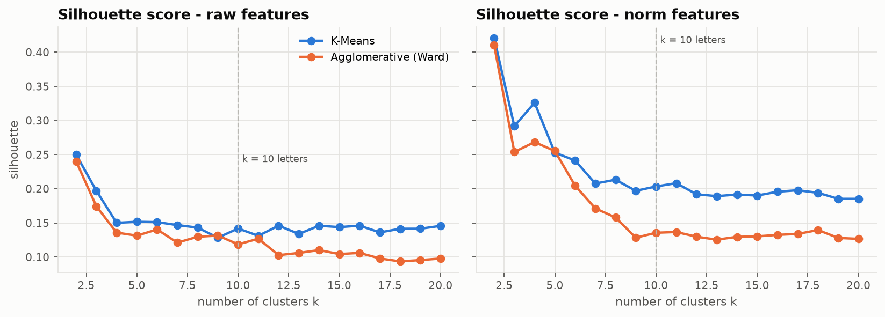
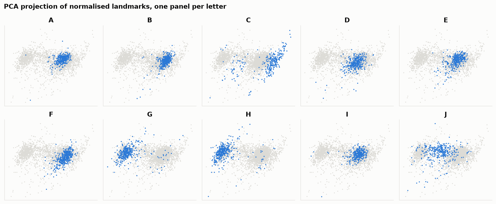

# Real-time ASL Hand-Gesture Recognition (A–J)

[](https://github.com/cpg25ncu/asl-gesture-recognition/actions/workflows/ci.yml)


[中文说明](README.zh-CN.md)

Recognises the American Sign Language letters **A–J** from a webcam in real time.
MediaPipe tracks 21 hand landmarks per frame. The landmark geometry is then
**normalised** for position, size and frame aspect ratio, and classified with
classical machine learning, including a **k-nearest-neighbours classifier
written from scratch in pure Python**.

<p align="center"></p>
<p align="center"><sub>Demo clip generated from the author's own photos (moving hand, plain and cluttered backgrounds), processed frame by frame by the streaming pipeline.</sub></p>

> **Background.** This started as a group project in an undergraduate AI module at
> the University of East Anglia (2025–26), where I built the whole technical
> pipeline: feature extraction, cleaning, from-scratch kNN, model tuning and
> clustering. I later rebuilt it as a reproducible package and extended it with a
> real-time pipeline, landmark normalisation and a robustness study.

## Highlights

| | |
|---|---|
| **96.9 %** test accuracy | Logistic Regression on normalised landmarks; 1,081 held-out images; macro-F1 96.9 % |
| **95.7 %** with kNN from scratch | Standard library only (`math`, `heapq`); unit-tested to match scikit-learn's predictions exactly |
| Normalisation helps every model | Clean test set: Decision Tree 89.8 → 94.2 %, kNN 95.0 → 95.7 %, LR 96.3 → 96.9 %. With the hand shifted and resized: Decision Tree 53.6 → 92.6 %, kNN 70.6 → 93.5 % |
| Robust to unseen conditions | 85 % end to end on cluttered backgrounds. Pre-processing rescues hard cases: low light 44 → 89 % (adaptive gamma), sensor noise 4 → 87 % (denoising) |
| Real time on a laptop CPU | **129 FPS** (7.8 ms per 640×480 frame) with landmark tracking, 2.1× faster than detecting on every frame |
| Reproducible | One CLI, fixed seeds, a saved train/test split, 22 unit tests, GitHub Actions CI |

## How it works

<p align="center"></p>

1. **Landmarks.** MediaPipe Hands returns 21 (x, y, z) keypoints, a 63-value vector.
   In video mode, MediaPipe runs its palm detector only when tracking is lost, which
   is the main reason the pipeline runs in real time.
2. **Normalisation** ([`features.py`](src/aslgesture/features.py)). MediaPipe's x and y
   are fractions of the frame width and height, so the raw vector encodes where the
   hand is and how big it looks as much as the gesture itself. The pipeline rescales
   to isotropic units (so a 640×480 frame doesn't squash the hand), moves the wrist
   to the origin and divides by the palm length (wrist → middle-finger knuckle).
3. **Classification.** Three model families are tuned with stratified 5-fold
   cross-validation. Every grid includes the library defaults as a baseline.
4. **Temporal smoothing.** Class probabilities are averaged over the last 5 frames,
   so the displayed letter doesn't flicker. Predictions below 50 % confidence are
   shown as "?".

## Results

### Data

| | |
|---|---|
| Images | 3,781 photos of ASL A–J (256×256) from about 125 contributors, various skin tones, backgrounds and lighting |
| Hand detected by MediaPipe | 3,661 (120 failures, logged and excluded as noise) |
| Exact duplicates removed | 59 images with identical landmarks. One duplicate group even carried conflicting labels. Left in, duplicates can leak between the training and test sets |
| Final set | 3,602 samples, stratified 70/30 split: 2,521 train / 1,081 test |
| Extraction speed | 67 s for all 3,781 images (56 images/s, CPU only) |

<p align="center"></p>

### Supervised learning (held-out test set)

| Model | Feature set | Best hyper-parameters (5-fold CV) | CV accuracy | Test accuracy | Test macro-F1 |
|---|---|---|---|---|---|
| kNN (from scratch) | raw | k=5, distance-weighted | 95.2 ± 1.1 % | 95.0 % | 94.9 % |
| Decision Tree | raw | max_depth=None, min_samples_split=2 | 90.1 ± 1.2 % | 89.8 % | 89.4 % |
| Logistic Regression | raw | C=1, L1 | 95.9 ± 1.2 % | 96.3 % | 96.2 % |
| kNN (from scratch) | **norm** | k=5, distance-weighted | 95.5 ± 0.5 % | 95.7 % | 95.6 % |
| Decision Tree | **norm** | max_depth=15, min_samples_split=2 | 93.3 ± 0.7 % | 94.2 % | 94.0 % |
| **Logistic Regression** | **norm** | C=100, L2 | 95.7 ± 0.9 % | **96.9 %** | **96.9 %** |
| kNN (from scratch) | norm_rot | k=1 | 92.0 ± 1.0 % | 91.9 % | 91.6 % |
| Decision Tree | norm_rot | max_depth=15, min_samples_split=20 | 88.4 ± 0.7 % | 88.8 % | 88.6 % |
| Logistic Regression | norm_rot | C=1, L2 | 91.4 ± 1.1 % | 92.1 % | 91.9 % |
| kNN (from scratch) | norm_aug | k=5, distance-weighted | 95.8 ± 0.8 % | 95.4 % | 95.3 % |
| Decision Tree | norm_aug | max_depth=10, min_samples_split=5 | 93.9 ± 0.4 % | 92.5 % | 92.3 % |
| Logistic Regression | norm_aug | C=1, L1 | 95.7 ± 1.1 % | 96.4 % | 96.3 % |

`norm_aug` uses the same features as `norm`, but the training set gets 3 extra
copies of each hand, rotated at random by up to ±30°. Augmentation is applied
inside each CV fold, after the split, so rotated copies of a validation hand never
leak into its training fold.

<p align="center"></p>

* **Normalisation (`norm`) improves every model.** It also lowers the CV variance for
  kNN and the Decision Tree. The tree gains the most (+4.4 points): it splits on one
  coordinate at a time, so it suffers most when the same gesture appears at different
  positions and sizes.
* **Rotation alignment (`norm_rot`) hurts (−4 to −5 points).** Some letters differ
  mainly in orientation. I and J are the clearest case (J is drawn by tilting the
  I-hand), so rotating every hand upright throws away a useful cue.
* **Rotation augmentation (`norm_aug`) is a trade-off.** It makes models more tolerant
  of tilted hands (Logistic Regression under ±30° rotation: 87.2 → 90.9 %; Decision
  Tree: 74.5 → 87.0 %). It also weakens the orientation cue for J: J recall falls from
  90.5 to 87.6 % on the test set, and on the demo clip J is held for 17 of 40 frames
  instead of 31. **The demo therefore ships Logistic Regression + `norm`**. Selection
  used cross-validation, where `norm` and `norm_aug` tie at 95.7 %, plus the I/J
  behaviour, not test accuracy.
* On clean, centred images, raw and normalised Logistic Regression are within CV
  noise of each other. The real benefit of normalisation shows up when the hand
  moves around the frame (see the robustness results below).
* The remaining errors are mostly **I ↔ J** (7 each way): J is a *motion* sign, and a
  single frame of it looks very much like I.

<p align="center">

</p>

Hyper-parameter search, one figure per feature set ([raw](reports/figures/cv_tuning_raw.png) · [norm](reports/figures/cv_tuning_norm.png) · [norm_rot](reports/figures/cv_tuning_norm_rot.png) · [norm_aug](reports/figures/cv_tuning_norm_aug.png)):

<p align="center"></p>

### Robustness to unseen capture conditions

Every **test** image was re-rendered under conditions the dataset doesn't cover, and
the full pipeline (detection + features + classifier) was run end to end. An image
counts as wrong if MediaPipe loses the hand. Complex backgrounds were made by
segmenting the hand with **OpenCV GrabCut**, seeded from its landmarks, and placing
it on cluttered scenes. Examples, using only the author's own photos:

<p align="center"></p>

End-to-end test accuracy (%). The "MediaPipe detection" column is the share of images in which a hand was found at all:

| Condition | MediaPipe detection | Decision Tree raw → norm | kNN raw → norm | LR raw → norm | LR norm_aug |
|---|---|---|---|---|---|
| clean | 100 % | 89.8 → 94.2 | 95.0 → 95.7 | 96.3 → **97.0** | 96.4 |
| complex background | 89.5 % | 78.3 → 82.3 | 83.4 → 84.0 | 85.2 → 85.1 | 85.0 |
| blur (σ = 2.5 px) | 97.0 % | 85.9 → 90.0 | 91.8 → 91.2 | 92.6 → 93.2 | 93.2 |
| rotation ±15–30° | 99.1 % | 79.3 → 74.5 | 87.8 → 79.2 | 89.4 → 87.2 | **90.9** |
| shift & scale (hand 55–75 % size, off-centre) | 97.7 % | **53.6 → 92.6** | **70.6 → 93.5** | 91.5 → 95.0 | 94.9 |
| webcam-like (background + rotation + shift + blur) | 84.6 % | 53.5 → 74.9 | 68.5 → 76.4 | 76.6 → 78.3 | 79.2 |
| low light | 48.6 % | 41.2 → 44.2 | 44.5 → 44.2 | 44.3 → 44.5 | 44.1 |
| low light + CLAHE | 31.8 % | 26.5 → 28.5 | 29.1 → 29.0 | 29.0 → 29.1 | 29.3 |
| low light + **adaptive gamma** | 92.9 % | 82.4 → 87.7 | 88.4 → 88.0 | 88.8 → **89.4** | 88.5 |
| sensor noise (σ = 15) | 4.9 % | 3.4 → 4.0 | 3.9 → 4.0 | 4.0 → 4.2 | 4.0 |
| sensor noise + **median denoise** | 90.2 % | 79.5 → 84.6 | 85.3 → 85.5 | 86.5 → **86.6** | 86.0 |

<p align="center"></p>

What this shows:

* **Normalisation is what makes the classifier position- and scale-independent.**
  When the hand is shifted and shrunk, the raw-coordinate Decision Tree collapses to
  53.6 % and kNN to 70.6 %. With normalised features they stay at 92–94 %.
* **The bottleneck under hard conditions is detection, not classification.** With a
  cluttered background, 95 % of the hands MediaPipe *does* find are classified
  correctly; the losses come from the 10.5 % it misses. Low light and noise mostly
  stop MediaPipe from finding the hand at all.
* **Cheap OpenCV pre-processing fixes most of that.** MediaPipe's palm detector turned
  out to be very sensitive to per-pixel noise (σ = 15 → 4.9 % detection). A 5×5 median
  filter (≈1 ms) restores detection to 90 %. For dark frames, adaptive gamma (only
  ever brightens, < 1 ms) restores it from 48.6 to 92.9 %. **CLAHE made things worse**
  (31.8 %): it amplifies noise in dark regions. Both kept steps were also checked on
  clean images: gamma leaves them untouched, and denoising costs about 1 point. That is
  why they are options (`--auto-gamma`, `--denoise`) rather than always on.
* Rotation is the one case where raw features hold up better than `norm` for kNN and
  the tree. Rotation augmentation closes that gap; see the trade-off discussed above.

### Real-time performance

Measured on a 400-frame 640×480 clip (`asl-gesture benchmark`) on a laptop CPU (AMD Ryzen AI 9 HX 370, no GPU).
The time covers the whole per-frame pipeline except camera capture and drawing:

| Setting | Throughput | Mean latency | Pre-processing | MediaPipe | Features + classifier |
|---|---|---|---|---|---|
| Detect hand on every frame | 62 FPS | 16.1 ms | – | 15.3 ms | 0.7 ms |
| **Track landmarks across frames (default)** | **129 FPS** | **7.8 ms** | – | 7.1 ms | 0.6 ms |
| + adaptive gamma | 129 FPS | 7.7 ms | 0.4 ms | 6.8 ms | 0.5 ms |
| + median denoise | 114 FPS | 8.8 ms | 1.4 ms | 6.8 ms | 0.6 ms |
| + both | 108 FPS | 9.3 ms | 1.8 ms | 6.9 ms | 0.6 ms |

Tracking roughly halves the per-frame cost, because the palm detector only runs
when the hand is lost. Even with both pre-processing steps on, the pipeline runs at
over 3× a typical webcam's 30 FPS. For comparison, the pure-Python kNN needs
≈1.8 ms per prediction versus 0.2 ms for Logistic Regression. kNN would also fit the
real-time budget, but Logistic Regression is faster, more accurate and stores no
training data.

### Unsupervised learning: does the data cluster into letters?

K-Means and agglomerative (Ward) clustering were run on the landmarks without
labels, for k = 2…20. Labels were used only afterwards, to score the clusters.

| Features | Method (k=10) | Silhouette | Purity | ARI | NMI |
|---|---|---|---|---|---|
| raw | K-Means | 0.14 | 0.47 | 0.28 | 0.42 |
| raw | Agglomerative (Ward) | 0.12 | 0.49 | 0.37 | 0.52 |
| norm | K-Means | 0.20 | 0.46 | 0.30 | 0.47 |
| norm | Agglomerative (Ward) | 0.14 | 0.46 | 0.28 | 0.45 |

The silhouette peaks at k = 2–4, not at 10. The letters don't form ten separate
natural clusters. The cluster/letter table shows why: clustering merges letters
with almost the same hand shape (**B + F**, **G + H**, **I + J**). These are the same
pairs that labelled classifiers sometimes confuse. With labels, the classifiers
reach about 97 %. Without labels, mapping each cluster to its majority letter gives
under 50 %.

<p align="center">


</p>
<p align="center"></p>

## Quick start

```bash
git clone https://github.com/cpg25ncu/asl-gesture-recognition.git
cd asl-gesture-recognition
python -m venv .venv && source .venv/bin/activate   # Windows: .venv\Scripts\activate
pip install -r requirements.txt && pip install -e . --no-deps
```

Python 3.11 or 3.12 is required (MediaPipe 0.10.14; versions pinned in `requirements.txt`). A trained model (8 KB) is included in [`models/`](models).

```bash
asl-gesture demo                       # webcam, press q to quit
asl-gesture demo --left-hand           # mirror frames for a left hand
asl-gesture demo --auto-gamma --denoise   # dim or noisy cameras
asl-gesture demo --source clip.mp4 --save out.mp4 --no-display
asl-gesture predict examples/own_images/B_1.jpg
```

Reproduce everything from your own images (see [`data/README.md`](data/README.md)):

```bash
asl-gesture extract        # MediaPipe -> data/processed/landmarks.csv
asl-gesture train          # CV tuning + test evaluation, 3 models x 4 feature sets
asl-gesture export-model --model lr --feature-set norm
asl-gesture cluster        # K-Means / agglomerative analysis
asl-gesture robustness     # synthetic capture conditions
asl-gesture make-demo-video && asl-gesture benchmark --source data/demo_input.mp4
pytest
```

## Project structure

```
src/aslgesture/
├── landmarks.py    MediaPipe wrapper (image + tracking modes), dataset extraction
├── features.py     raw / normalised / rotation-aligned features, rotation augmentation
├── knn.py          kNN from scratch (standard library only)
├── supervised.py   cleaning, split, 5-fold CV grid search, evaluation, plots
├── clustering.py   K-Means, agglomerative, purity / ARI / NMI, PCA
├── robustness.py   GrabCut segmentation, cluttered backgrounds, perturbations,
│                   pre-processing (median denoise, adaptive gamma, CLAHE)
├── realtime.py     streaming pipeline, smoothing, overlay, benchmark, demo clip
└── cli.py          `asl-gesture` command line
tests/              kNN vs scikit-learn, normalisation invariances, pre-processing
reports/            all figures and result tables used in this README
models/             trained Logistic Regression model used by the demo
examples/           30 photos of the author's own hand (3 per letter)
```

## Limitations

* **Static letters only.** J (and Z) are motion signs in ASL. Here J is recognised
  from a single frame, which is why most of the remaining errors are I ↔ J. A
  sequence model over landmark trajectories would be the natural next step.
* The robustness study uses **synthetic** perturbations of real test photos, and the
  FPS benchmark uses a clip animated from still photos. Both isolate one factor at a
  time, but neither replaces a test set recorded live on a webcam.
* Low light remains the weakest condition without pre-processing (44 %). With
  adaptive gamma it reaches 89 %.
* The training images are mostly right hands. Left hands are supported by mirroring
  (`--left-hand`).
* The training dataset can't be redistributed (see [`data/README.md`](data/README.md)).

## Acknowledgements

* [MediaPipe Hands](https://ai.google.dev/edge/mediapipe/solutions/vision/hand_landmarker) by Google for landmark detection.
* The classmates who contributed photos to the course dataset, and my project
  teammate for discussions and presentation work.
* The cluttered-background tests use two photos bundled with scikit-learn
  (`china.jpg`, `flower.jpg`), CC BY 2.0, by Flickr users *danielbuechele* and *vultilion*.
