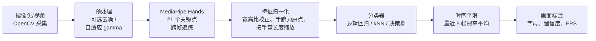

# 实时 ASL 手势识别（A–J）

[English](README.md)

基于 MediaPipe 手部关键点与机器学习的实时手势识别系统，识别美国手语字母 **A–J**：

- 用 OpenCV 采集摄像头画面；
- 用 MediaPipe 逐帧检测并跨帧追踪 21 个手部关键点；
- 对关键点做**特征归一化**，消除手在画面中的位置、大小和画面宽高比的影响；
- 用机器学习模型分类，其中包括一个**只用 Python 标准库手写的 kNN**。

<p align="center"></p>
<p align="center"><sub>演示片段：由作者本人拍摄的手势照片合成，包含手部移动、纯色背景和复杂背景，逐帧经过实时处理流程。</sub></p>

> **项目背景**：项目起源于东英吉利大学本科人工智能课程的小组项目（2025–26），我负责全部技术实现：特征提取、数据清洗、手写 kNN、模型调参和聚类分析。之后我把它重构为可复现的 Python 包，并扩展了实时识别流程、关键点归一化和鲁棒性评估。

## 亮点

| | |
|---|---|
| 测试集准确率 **96.9%** | 归一化特征 + 逻辑回归，在 1,081 张未参与训练的图片上测得，macro-F1 96.9% |
| 手写 kNN **95.7%** | 只用标准库（`math`、`heapq`），单元测试验证与 scikit-learn 的预测完全一致 |
| 归一化对所有模型都有提升 | 干净测试集：决策树 89.8 → 94.2%，kNN 95.0 → 95.7%，逻辑回归 96.3 → 96.9%。手在画面中位移、缩小后：决策树 53.6 → 92.6%，kNN 70.6 → 93.5% |
| 不同拍摄条件下的鲁棒性 | 复杂背景下端到端准确率 85%。预处理能救回困难场景：低光 44 → 89%（自适应 gamma），传感器噪声 4 → 87%（中值滤波去噪） |
| CPU 上实时运行 | 开启关键点跨帧追踪后 **129 FPS**（每帧 640×480 耗时 7.8 ms），比逐帧检测快 2.1 倍 |
| 可复现 | 统一命令行、固定随机种子、固定训练/测试切分、22 个单元测试、GitHub Actions 持续集成 |

## 处理流程



## 主要结论

- **特征归一化**：MediaPipe 输出的 x、y 坐标是相对画面宽高的比例，原始特征里混入了手的位置和大小。以手腕为原点、按手掌长度缩放之后，三个模型的准确率都有提升，决策树提升最多（+4.4 个百分点）。
- **旋转对齐反而有害**（准确率下降 4–5 个百分点）：有些字母主要靠手的朝向区分，最典型的是 I 和 J。所以最终模型保留了朝向信息。
- **旋转数据增强是一个取舍**：训练时给每只手加 3 份随机旋转（±30°）的副本，手倾斜时的识别率会提高（逻辑回归 87.2 → 90.9%），但 J 的召回率从 90.5% 降到 87.6%。所以演示用的是不做增强的模型。
- **鲁棒性评估**：在测试图片上合成复杂背景（用 OpenCV GrabCut 分割手部后贴到复杂背景上）、低光、模糊、噪声、旋转和位移缩放等条件，然后跑完整流程：
  - 归一化让模型不再受手的位置和大小影响：手位移、缩小后，用原始坐标的决策树只有 53.6%，归一化后是 92.6%。
  - 困难场景下的主要瓶颈是 MediaPipe 根本检测不到手，而不是分类错误。
  - 中值滤波去噪（约 1 ms）把噪声下的检测率从 4.9% 提到 90.2%；自适应 gamma（不到 1 ms）把低光下的检测率从 48.6% 提到 92.9%。CLAHE 反而让检测率降到 31.8%，所以没有采用。
- **剩下的错误主要集中在 I ↔ J**：J 在手语里是一个动作，单独一帧看起来和 I 很像。
- **数据清洗**：发现并去除了 59 张关键点完全相同的重复图片，其中一组还带着相互矛盾的标签。如果不去重，同一张图片可能同时出现在训练集和测试集里，导致结果虚高。
- **聚类**：K-Means 和层次聚类（k=10）的纯度只有约 0.46–0.49。聚类会把手型几乎相同的字母合在一起（B+F、G+H、I+J），这也正是分类器容易混淆的几对。

详细的数据、图表和复现步骤见 [英文 README](README.md)。

## 快速开始

```bash
pip install -r requirements.txt && pip install -e . --no-deps
asl-gesture demo                 # 打开摄像头实时识别，按 q 退出
asl-gesture predict 图片.jpg      # 识别单张图片
```

需要 Python 3.11 或 3.12。训练数据集不能公开分发，说明见 [`data/README.md`](data/README.md)。
