<h1 align="center">实时 ASL 手势识别（A–J）</h1>

<p align="center">
  <a href="README.md">English</a> &nbsp;|&nbsp; <b>简体中文</b>
</p>

<p align="center">
  <a href="https://github.com/cpg25ncu/asl-gesture-recognition/actions/workflows/ci.yml"></a>
  
  <a href="LICENSE"></a>
  <a href="https://github.com/cpg25ncu/asl-gesture-recognition/releases/latest"></a>
</p>

通过摄像头实时识别美国手语（ASL）字母 **A–J**。系统用 MediaPipe 逐帧追踪手部 21 个关键点，把关键点几何形状按位置、大小和画面宽高比做**归一化**，再用传统机器学习模型分类。其中包括一个**只用 Python 标准库手写的 k 近邻（kNN）分类器**。

<p align="center">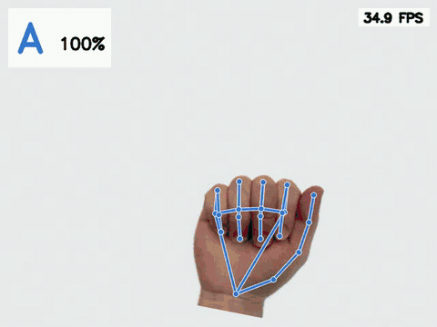</p>
<p align="center"><sub>演示片段由作者本人拍摄的手势照片合成（手部移动，纯色背景和复杂背景交替），逐帧经过实时处理流程。</sub></p>

> **项目背景**：项目起源于东英吉利大学本科人工智能课程的小组项目（2025–26），我负责全部技术实现：特征提取、数据清洗、手写 kNN、模型调参和聚类分析。之后我把它重构为可复现的 Python 包，并扩展了实时识别流程、关键点归一化和鲁棒性评估。

## 亮点

准确率按两种口径报告：
- **端到端准确率**：统计全部测试图片，MediaPipe 没检测到手的图片算作识别错误；
- **分类准确率**：只统计检测到手的图片。

| | |
|---|---|
| 端到端测试准确率 **93.8%** | 全部 1,117 张测试图片（MediaPipe 在其中 96.8% 检测到手）。在 1,081 张检测到手的图片上，分类器（逻辑回归）准确率为 **96.9%**，macro-F1 96.9% |
| 手写 kNN | 只用标准库（`math`、`heapq`），单元测试验证与 scikit-learn 的预测完全一致。端到端 92.7%，分类准确率 95.7% |
| 归一化对所有模型都有提升 | 分类准确率：决策树 89.8 → 94.2%，kNN 95.0 → 95.7%，逻辑回归 96.3 → 96.9%。手在画面中位移、缩小后的端到端准确率：决策树 51.8 → 89.6%，kNN 68.3 → 90.5% |
| 不同拍摄条件下的鲁棒性 | 端到端：复杂背景下 82%。预处理能救回困难场景：低光 43 → 87%（自适应 gamma），传感器噪声 4 → 84%（中值滤波去噪） |
| CPU 上实时运行 | 开启关键点跨帧追踪后 **129 FPS**（每帧 640×480 耗时 7.8 ms），比逐帧检测快 2.1 倍 |
| 可复现 | 统一命令行、固定随机种子、保存的训练/测试切分、23 个单元测试、GitHub Actions 持续集成 |

## 工作原理

<p align="center">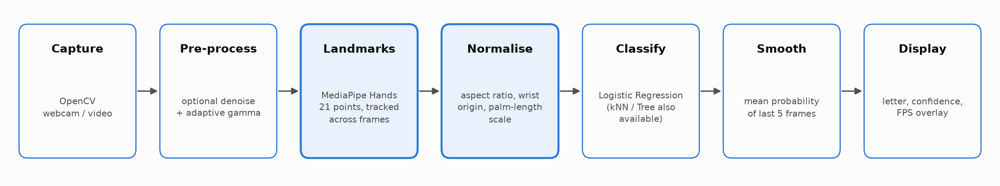</p>

1. **关键点**：MediaPipe Hands 返回 21 个 (x, y, z) 关键点，共 63 个数值。视频模式下，MediaPipe 只在跟丢时才重新运行手掌检测器，这是整个流程能实时运行的主要原因。
2. **归一化**（[`features.py`](src/aslgesture/features.py)）：MediaPipe 的 x、y 是相对画面宽、高的比例，原始特征里除了手势本身，还混入了手在画面中的位置和大小。流程先换算成各向同性的单位（避免 640×480 画面把手形压扁），再以手腕为原点、除以手掌长度（手腕到中指根部的距离）。
3. **分类**：三类模型都用分层 5 折交叉验证调参，每个参数网格都包含库的默认参数作为基线。
4. **时序平滑**：对最近 5 帧的类别概率取平均，显示的字母不会来回闪烁；置信度低于 50% 时显示"?"。

## 结果

### 数据

| | |
|---|---|
| 图片 | 3,781 张 ASL A–J 手势照片（256×256），来自约 125 位拍摄者，肤色、背景和光照各不相同 |
| MediaPipe 检测到手 | 3,661 / 3,781（96.8%）。其余 120 张（去重后 119 张）没有关键点，无法用于训练，但**每个端到端指标都把它们计入测试集并算作错误** |
| 去除完全重复的样本 | 59 张关键点完全相同的图片，外加未检测到手的图片中 1 组重复；其中一组重复图片的标签还相互矛盾。保留重复样本会让同一张图同时出现在训练集和测试集里 |
| 切分 | 按字母分层 70/30，固定随机种子。**训练集**：2,521 张有关键点的图片。**测试集**：1,117 张，其中 1,081 张检测到手、36 张未检测到手 |
| 提取速度 | 3,781 张图片共 67 秒（每秒 56 张，仅用 CPU） |

<p align="center">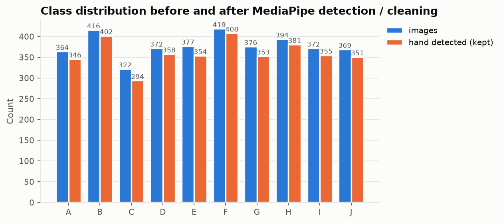</p>

### 监督学习（测试集）

| 模型 | 特征 | 最佳超参数（5 折交叉验证） | 交叉验证准确率 | **端到端**准确率（1,117 张） | 分类准确率（1,081 张检测到手） | 分类 macro-F1 |
|---|---|---|---|---|---|---|
| kNN（手写） | raw | k=5，距离加权 | 95.2 ± 1.1% | 91.9% | 95.0% | 94.9% |
| 决策树 | raw | max_depth=None, min_samples_split=2 | 90.1 ± 1.2% | 86.9% | 89.8% | 89.4% |
| 逻辑回归 | raw | C=1, L1 | 95.9 ± 1.2% | 93.2% | 96.3% | 96.2% |
| kNN（手写） | **norm** | k=5，距离加权 | 95.5 ± 0.5% | 92.7% | 95.7% | 95.6% |
| 决策树 | **norm** | max_depth=15, min_samples_split=2 | 93.3 ± 0.7% | 91.1% | 94.2% | 94.0% |
| **逻辑回归** | **norm** | C=100, L2 | 95.7 ± 0.9% | **93.8%** | **96.9%** | **96.9%** |
| kNN（手写） | norm_rot | k=1 | 92.0 ± 1.0% | 88.9% | 91.9% | 91.6% |
| 决策树 | norm_rot | max_depth=15, min_samples_split=20 | 88.4 ± 0.7% | 85.9% | 88.8% | 88.6% |
| 逻辑回归 | norm_rot | C=1, L2 | 91.4 ± 1.1% | 89.2% | 92.1% | 91.9% |
| kNN（手写） | norm_aug | k=5，距离加权 | 95.8 ± 0.8% | 92.3% | 95.4% | 95.3% |
| 决策树 | norm_aug | max_depth=10, min_samples_split=5 | 93.9 ± 0.4% | 89.5% | 92.5% | 92.3% |
| 逻辑回归 | norm_aug | C=1, L1 | 95.7 ± 1.1% | 93.3% | 96.4% | 96.3% |

交叉验证在训练集上进行，训练集里的图片都有关键点。四种特征：
- `raw`：MediaPipe 原始坐标；
- `norm`：位置、大小归一化；
- `norm_rot`：在 `norm` 基础上再把手旋转摆正；
- `norm_aug`：特征和 `norm` 相同，但训练时给每只手再加 3 份随机旋转（±30°以内）的副本。数据增强在每一折切分之后才做，所以验证集里那只手的旋转副本不会混进同一折的训练数据。

<p align="center">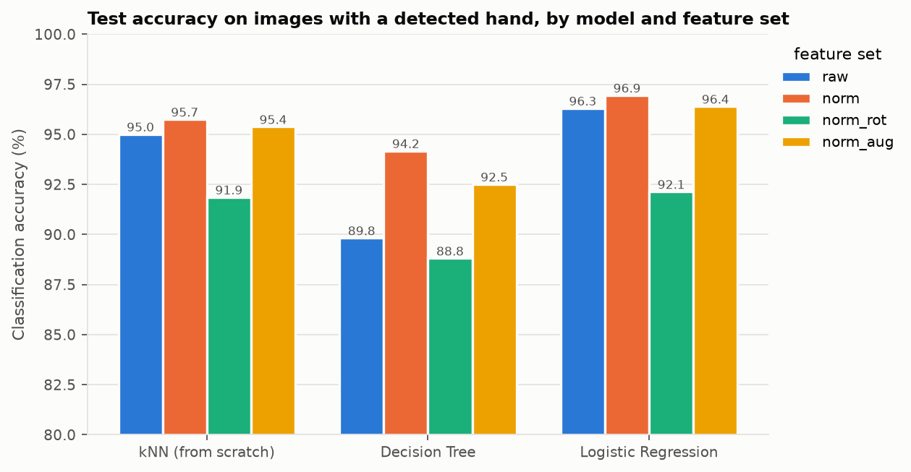</p>

* **归一化（`norm`）让每个模型都有提升**，kNN 和决策树的交叉验证方差也更小。决策树提升最多（+4.4 个百分点）：它每次只按一个坐标切分，同一个手势出现在不同位置、不同大小时，受影响最大。
* **旋转摆正（`norm_rot`）反而有害**（下降 4–5 个百分点）。有些字母主要靠手的朝向区分，最典型的是 I 和 J（J 是把 I 的手形倾斜着划出来的），把所有手都转正就丢掉了这个有用的线索。
* **旋转数据增强（`norm_aug`）是一个取舍**：
  * 好处：模型更能容忍倾斜的手。±30° 旋转下的端到端准确率，逻辑回归从 85.0% 升到 88.5%，决策树从 72.2% 升到 84.7%。
  * 代价：削弱了 J 的朝向线索。测试集上 J 的召回率从 90.5% 降到 87.6%；演示片段里 J 的 40 帧中只有 17 帧识别正确，原来是 31 帧。
  * **所以演示用的是逻辑回归 + `norm`**。选择依据是交叉验证（`norm` 和 `norm_aug` 同为 95.7%）加上 I/J 的表现，没有参考测试集准确率。
* 在干净、居中的图片上，原始坐标和归一化的逻辑回归差距在交叉验证误差范围内。归一化真正的价值体现在手在画面中移动的时候（见下面的鲁棒性结果）。
* **整个系统的错误从哪里来**：部署模型在 1,117 张测试图片中错了 69 张，其中 36 张是 MediaPipe 没检测到手，33 张是分类错误。分类错误里 **I ↔ J** 占大头（33 张里有 14 张）：J 在手语里是一个动作，单独一帧看起来和 I 很像。混淆矩阵把没检测到手的图片单独列为"no hand"一列。

<p align="center">
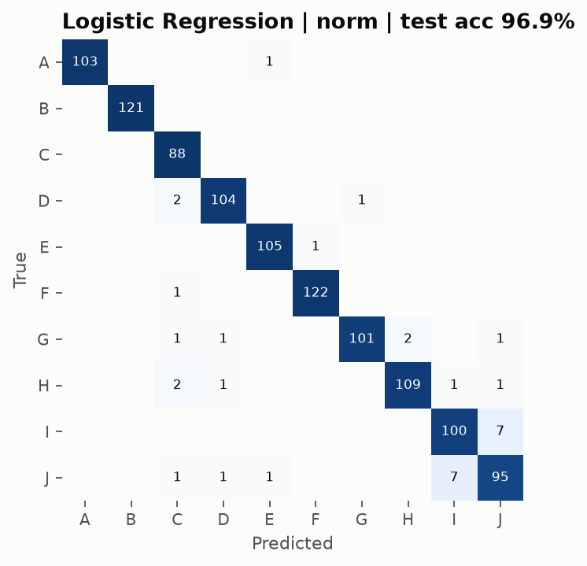
</p>

各特征的超参数搜索图（[raw](reports/figures/cv_tuning_raw.png) · [norm](reports/figures/cv_tuning_norm.png) · [norm_rot](reports/figures/cv_tuning_norm_rot.png) · [norm_aug](reports/figures/cv_tuning_norm_aug.png)）：

<p align="center">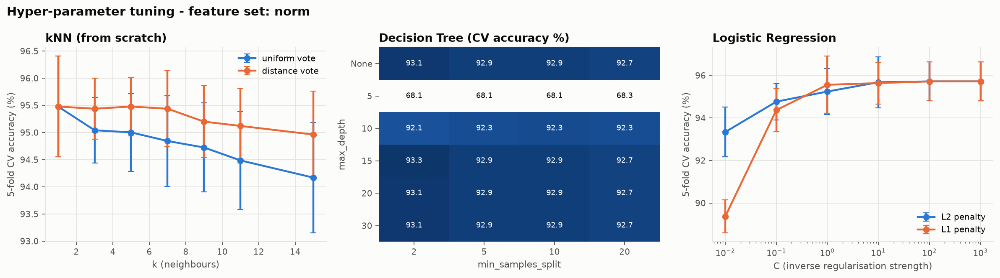</p>

### 不同拍摄条件下的鲁棒性

把全部 1,117 张**测试**图片分别渲染成数据集里没有的拍摄条件，然后跑完整流程（检测 + 特征 + 分类）。下面所有数字都是在这 1,117 张上统计的端到端准确率：MediaPipe 丢失手部就算错。

复杂背景的做法：用 **OpenCV GrabCut**（以关键点为种子）把手从原图分割出来，贴到杂乱的场景上。复杂背景、位移缩放和组合这三个条件需要先抠出手，而抠图依赖原图的关键点，所以没法用在那 36 张从一开始就没检测到手的图片上；这三项里它们一律算错。示例（只使用作者本人的照片）：

<p align="center">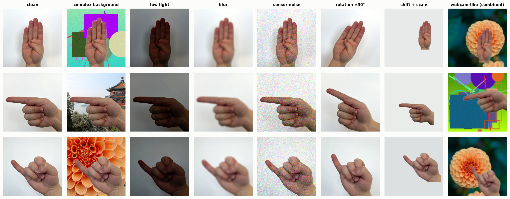</p>

全部 1,117 张测试图片上的端到端准确率（%）。"MediaPipe 检测率"是能找到手的图片比例：

| 条件 | MediaPipe 检测率 | 决策树 raw → norm | kNN raw → norm | 逻辑回归 raw → norm | 逻辑回归 norm_aug |
|---|---|---|---|---|---|
| 原图 | 96.8% | 86.9 → 91.1 | 91.9 → 92.7 | 93.2 → **93.8** | 93.3 |
| 复杂背景 | 86.6% | 75.7 → 79.7 | 80.7 → 81.3 | 82.4 → 82.4 | 82.3 |
| 模糊（σ = 2.5 像素） | 95.1% | 84.0 → 88.0 | 89.8 → 89.4 | 90.7 → 91.3 | 91.3 |
| 旋转 ±15–30° | 96.5% | 77.1 → 72.2 | 85.5 → 77.2 | 87.0 → 85.0 | **88.5** |
| 位移缩放（手缩到 55–75%，偏离中心） | 94.5% | **51.8 → 89.6** | **68.3 → 90.5** | 88.5 → 91.9 | 91.8 |
| 组合：复杂背景 + 旋转 + 位移 + 模糊 | 81.8% | 51.7 → 72.5 | 66.2 → 74.0 | 74.1 → 75.7 | 76.6 |
| 低光 | 47.3% | 39.8 → 42.9 | 43.2 → 43.0 | 43.1 → 43.2 | 42.8 |
| 低光 + CLAHE | 30.8% | 25.6 → 27.6 | 28.2 → 28.1 | 28.1 → 28.2 | 28.4 |
| 低光 + **自适应 gamma** | 90.5% | 80.1 → 85.3 | 85.9 → 85.5 | 86.4 → **87.0** | 86.1 |
| 传感器噪声（σ = 15） | 4.7% | 3.3 → 3.8 | 3.8 → 3.8 | 3.8 → 4.0 | 3.8 |
| 传感器噪声 + **中值滤波去噪** | 87.7% | 77.0 → 82.2 | 82.9 → 83.2 | 84.1 → **84.0** | 83.6 |

<p align="center">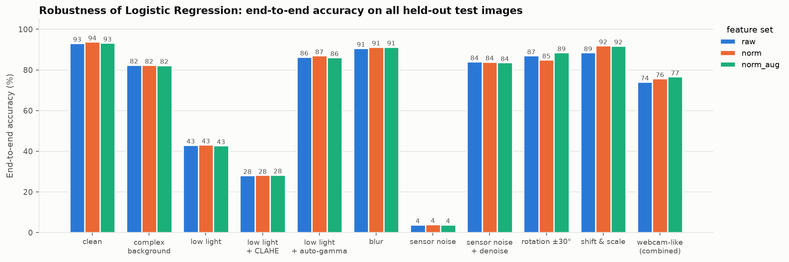</p>

结论：

* **归一化让分类器不再受手的位置和大小影响。** 手位移、缩小后，用原始坐标的决策树跌到 51.8%，kNN 跌到 68.3%；用归一化特征则都保持在 90% 左右。
* **困难条件下的瓶颈是检测，不是分类。** 复杂背景下，MediaPipe 检测到的手有 95% 分类正确，损失主要来自 13.4% 根本没检测到手的图片。低光和噪声主要也是让 MediaPipe 找不到手。
* **便宜的 OpenCV 预处理能解决大部分问题：**
  * MediaPipe 的手掌检测器对逐像素噪声非常敏感，σ = 15 时只能在 4.7% 的图片里找到手。5×5 中值滤波（约 1 ms）把检测率恢复到 87.7%。
  * 暗画面用自适应 gamma（只提亮、不压暗，不到 1 ms），检测率从 47.3% 恢复到 90.5%。
  * **CLAHE 反而更差**（30.8%）：它会放大暗部噪声。
* 两个保留下来的预处理也在原图上验证过：
  * gamma 只改动偏暗的图片，多找回了 36 张漏检中的 1 张（93.9% 对 93.8%）；
  * 去噪多找回 2 张，但又分错了几张，端到端净变化 −0.2 个百分点。
  * 所以它们作为可选项提供（`--auto-gamma`、`--denoise`），默认不开启。
* 旋转是唯一一种原始坐标对 kNN 和决策树反而更好的情况。旋转数据增强能弥补这个差距，代价见上文。

### 实时性能

在笔记本 CPU（AMD Ryzen AI 9 HX 370，无 GPU）上，用 400 帧 640×480 的片段测得（`asl-gesture benchmark`）。计时包含每帧完整的处理流程，不含摄像头读取和画面绘制：

| 设置 | 吞吐量 | 平均延迟 | 预处理 | MediaPipe | 特征 + 分类 |
|---|---|---|---|---|---|
| 每帧都重新检测手 | 62 FPS | 16.1 ms | – | 15.3 ms | 0.7 ms |
| **跨帧追踪关键点（默认）** | **129 FPS** | **7.8 ms** | – | 7.1 ms | 0.6 ms |
| + 自适应 gamma | 129 FPS | 7.7 ms | 0.4 ms | 6.8 ms | 0.5 ms |
| + 中值滤波去噪 | 114 FPS | 8.8 ms | 1.4 ms | 6.8 ms | 0.6 ms |
| + 两者都开 | 108 FPS | 9.3 ms | 1.8 ms | 6.9 ms | 0.6 ms |

追踪让每帧耗时大约减半，因为手掌检测器只在跟丢时才运行。即使两个预处理都打开，处理速度仍超过普通摄像头 30 FPS 的 3 倍。作为对比，纯 Python 的 kNN 每次预测约 1.8 ms，逻辑回归约 0.2 ms。kNN 也能满足实时要求，但逻辑回归更快、更准，而且不需要保存训练数据。

### 无监督学习：数据会自然聚成字母吗？

在不使用标签的情况下，对关键点做 K-Means 和层次聚类（Ward），k 从 2 取到 20；标签只在事后用于评估聚类结果。聚类需要关键点，所以这部分只覆盖 3,602 张检测到手的图片。

| 特征 | 方法（k=10） | 轮廓系数 | 纯度 | ARI | NMI |
|---|---|---|---|---|---|
| raw | K-Means | 0.14 | 0.47 | 0.28 | 0.42 |
| raw | 层次聚类（Ward） | 0.12 | 0.49 | 0.37 | 0.52 |
| norm | K-Means | 0.20 | 0.46 | 0.30 | 0.47 |
| norm | 层次聚类（Ward） | 0.14 | 0.46 | 0.28 | 0.45 |

轮廓系数在 k = 2–4 时最高，而不是 10：这些字母并不会自然形成十个独立的簇。聚类与字母的交叉表说明了原因：聚类会把手形几乎相同的字母合并在一起（**B + F**、**G + H**、**I + J**），这也正是有标签的分类器偶尔会混淆的几对。有标签时，分类器在同类图片（检测到手的图片）上达到 96.9%；没有标签时，把每个簇映射到其中最多的字母，准确率不到 50%。

<p align="center">
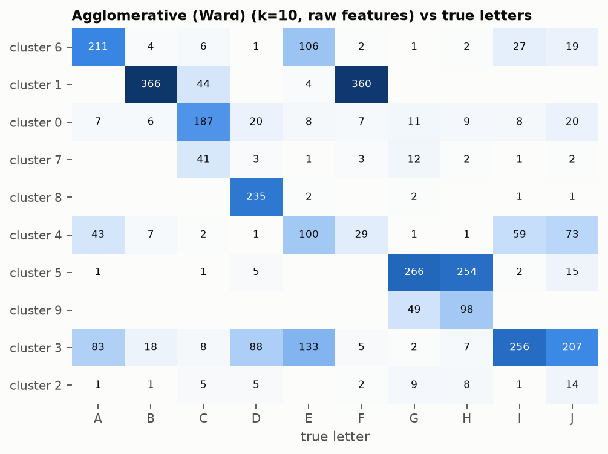
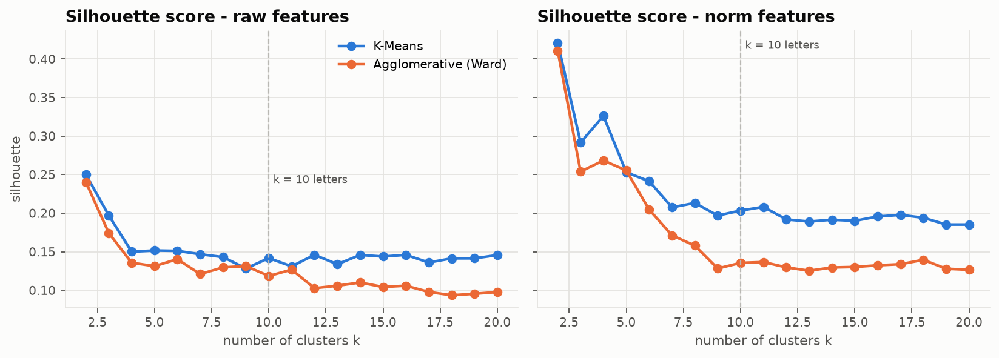
</p>
<p align="center">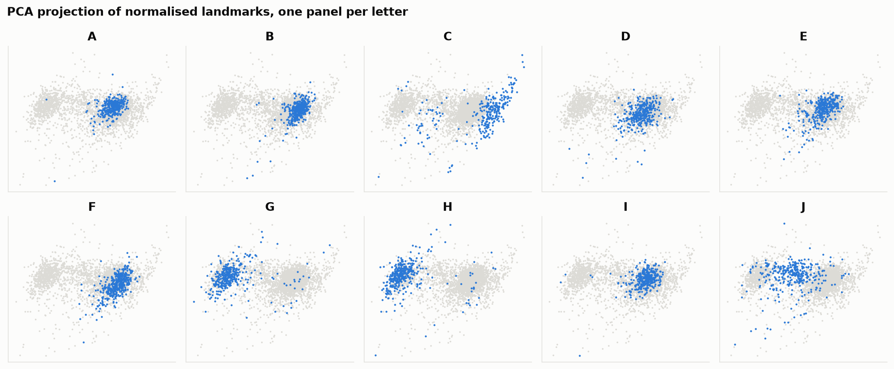</p>

## 快速开始

```bash
git clone https://github.com/cpg25ncu/asl-gesture-recognition.git
cd asl-gesture-recognition
python -m venv .venv && source .venv/bin/activate   # Windows: .venv\Scripts\activate
pip install -r requirements.txt && pip install -e . --no-deps
```

需要 Python 3.11 或 3.12（MediaPipe 0.10.14；依赖版本已在 `requirements.txt` 中固定）。仓库里自带训练好的模型（8 KB），位于 [`models/`](models)。

```bash
asl-gesture demo                       # 打开摄像头，按 q 退出
asl-gesture demo --left-hand           # 左手：镜像画面
asl-gesture demo --auto-gamma --denoise   # 光线暗或噪声大的摄像头
asl-gesture demo --source clip.mp4 --save out.mp4 --no-display
asl-gesture predict examples/own_images/B_1.jpg
```

用自己的图片完整复现所有结果（数据放置方式见 [`data/README.md`](data/README.md)）：

```bash
asl-gesture extract        # MediaPipe -> data/processed/landmarks.csv
asl-gesture train          # 交叉验证调参 + 测试集评估，3 个模型 x 4 种特征
asl-gesture export-model --model lr --feature-set norm
asl-gesture cluster        # K-Means / 层次聚类分析
asl-gesture robustness     # 合成拍摄条件下的鲁棒性评估
asl-gesture make-demo-video && asl-gesture benchmark --source data/demo_input.mp4
pytest
```

## 项目结构

```
src/aslgesture/
├── landmarks.py    MediaPipe 封装（图片模式 + 追踪模式）、数据集关键点提取
├── features.py     raw / 归一化 / 旋转摆正特征，旋转数据增强
├── knn.py          手写 kNN（只用标准库）
├── supervised.py   数据清洗、切分、5 折交叉验证网格搜索、评估、端到端指标
├── clustering.py   K-Means、层次聚类、纯度 / ARI / NMI、PCA
├── robustness.py   GrabCut 分割、复杂背景、各类干扰，
│                   预处理（中值滤波去噪、自适应 gamma、CLAHE）
├── realtime.py     实时处理流程、时序平滑、画面标注、性能测试、演示片段
└── cli.py          `asl-gesture` 命令行
tests/              kNN 与 scikit-learn 对拍、归一化不变性、预处理
reports/            本 README 用到的全部图表和结果表
models/             演示使用的逻辑回归模型
examples/           作者本人的 30 张手势照片（每个字母 3 张）
```

## 局限性

* **即使是原图，MediaPipe 也有约 3% 的手检测不到。** 这些图片无论后面用什么分类器都是错的，所以端到端准确率（93.8%）比分类准确率（96.9%）低约 3 个百分点。
* **只能识别静态字母。** 在 ASL 中 J（和 Z）是动作手势，这里只用单帧识别 J，所以大部分分类错误集中在 I ↔ J。下一步可以对关键点轨迹建立序列模型。
* 鲁棒性评估用的是对真实测试照片的**合成**干扰，FPS 测试用的是由静态照片生成的视频片段。两者都能单独隔离某一个因素，但都不能替代用摄像头实拍的测试集。
* 不做预处理时，低光仍是最弱的条件（端到端 43%）；开启自适应 gamma 后达到 87%。
* 训练图片主要是右手。左手可以通过镜像画面支持（`--left-hand`）。
* 训练数据集不能公开分发（见 [`data/README.md`](data/README.md)）。

## 致谢

* Google 的 [MediaPipe Hands](https://ai.google.dev/edge/mediapipe/solutions/vision/hand_landmarker)，用于关键点检测。
* 为课程数据集贡献照片的同学们，以及参与讨论和展示工作的项目队友。
* 复杂背景测试使用了 scikit-learn 自带的两张照片（`china.jpg`、`flower.jpg`），CC BY 2.0 许可，作者为 Flickr 用户 *danielbuechele* 和 *vultilion*。
